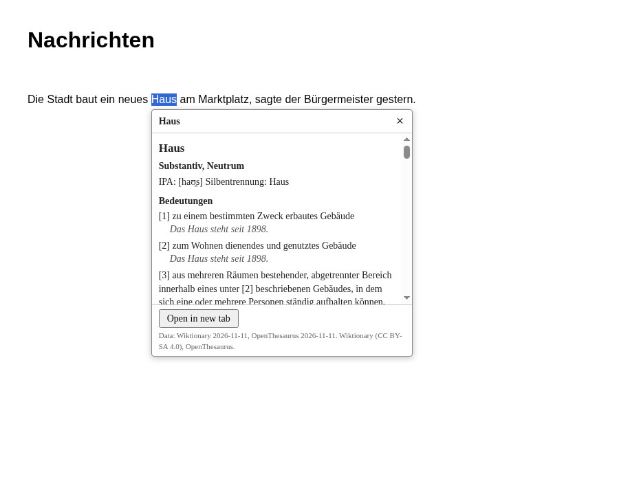

# Kindler Dictionary

A German → German dictionary for Firefox and Chrome. Select a word on any page, right-click, choose **Translate "word" in Kindler**, and its meaning appears in a small box next to the word, without leaving the page. Words with no German entry are looked up English → German instead. The box's **Open in new tab** button opens the full entry on [kindler.ink](https://kindler.ink/dictionary/).

Made for reading German news and texts in German, without switching to English.



## Requirements

- Firefox 140+ or Chrome/Chromium 121+
- An internet connection: lookups go to kindler.ink

## Installation

### Quick install (recommended)

- Firefox: [addons.mozilla.org](#) (coming soon)
- Chrome: [Chrome Web Store](#) (coming soon)

### From source

```
$ git clone https://github.com/kindlerz/KindlerDictionary
```

- Firefox: open `about:debugging#/runtime/this-firefox`, click **Load Temporary Add-on…** and pick `manifest.json`. It stays until Firefox closes.
- Chrome/Chromium: open `chrome://extensions`, turn on **Developer mode**, click **Load unpacked** and pick the folder.

## Usage

| Action | Result |
|---|---|
| Select a word, right-click, **Translate "word" in Kindler** | Box with the meaning next to the word |
| **Open in new tab** | Full entry on kindler.ink |
| Esc, click outside, or × | Close the box |

Punctuation around the selection is dropped (`„Haus,“` looks up `Haus`). Multi-word entries like `guten Tag` work too.

## Notes

- **Privacy:** only the selected text is sent to kindler.ink, and only when you click the menu item. The add-on cannot read pages on its own: it runs on a page only after you use its menu item there.
- **Frames:** for a selection inside an embedded frame from another site, the box opens in the top-right corner of the page.
- **Local Kindler:** to test against a Kindler running on your machine, change `KINDLER` in `background.js` (for example `http://127.0.0.1:5000`) and add `"http://127.0.0.1/*"` to `host_permissions` in `manifest.json`.
- **Publishing:** step-by-step store guides are in [publish/](publish/README.md). Privacy policy: [PRIVACY.md](PRIVACY.md).
- **Packaging** for the stores: `./package.sh` builds `kindler-dictionary-<version>.zip` (version from `manifest.json`) with only the add-on's files. Bump `"version"` before each store upload.

- **Data:** entries come from [wort](https://github.com/kasramp/wort), built from [German Wiktionary](https://de.wiktionary.org/) (CC BY-SA 4.0, via [kaikki.org](https://kaikki.org/)) and [OpenThesaurus](https://www.openthesaurus.de/).

## License

GPL-3.0, like [Kindler](https://github.com/kindlerz/Kindler). See [LICENSE](LICENSE).
